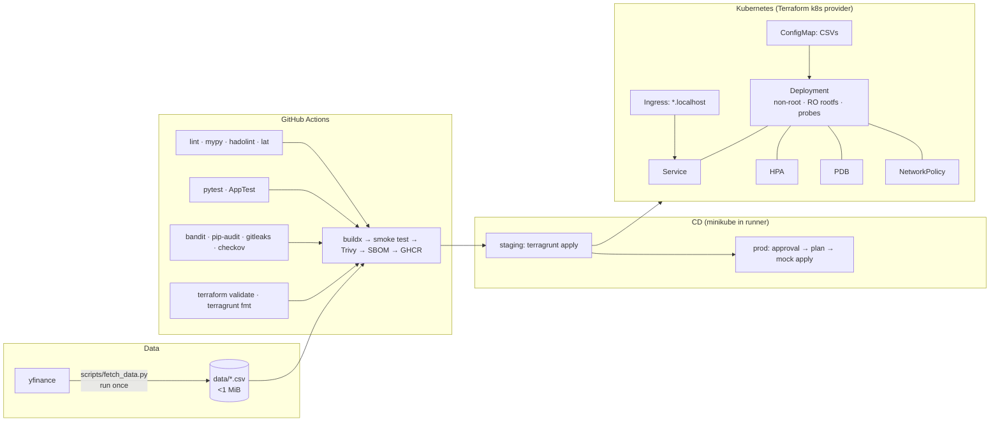

# bcc-s2

BlueCrest Capital – Stage 2 take-home. A containerised **Streamlit market dashboard** (VOD.L vs telecom peers: price timeseries, peer analytics, risk, 3D implied-vol surface) that reads CSV data on startup. It ships with GitHub Actions CI/CD, DevSecOps tooling, and a **Terraform + Terragrunt** Kubernetes deployment that runs for real on **minikube**.

> Built with **Claude Code** (Anthropic, Opus 5.5, paid subscription). Key prompts and outcomes: [PROMPTS.md](PROMPTS.md).

## Architecture



## Features

**App** (`src/bcc_s2/`)
- CSVs loaded once at startup (cached), validated, fail fast. Config is 100% env-driven (`DATA_DIR`, `APP_ENV`, `APP_VERSION`, `DEFAULT_TICKER`, …).
- KPI tiles: last price / 1D, total return, annualised vol, Sharpe, max drawdown.
- Tabs: **Price** (candlestick, SMA 20/50, volume) · **Peers** (rebased performance, focus vs peer average, correlation heatmap, summary) · **Risk** (rolling vol, drawdown, return histogram) · **Vol surface** (3D surface, smile slice, ATM term structure) · **Data** (filtered table, CSV download).

**Testing** (all via pytest)
- Unit tests for data and analytics, plus a native Streamlit `AppTest` suite (`pytest`).
- Playwright browser suite against a live server (`pytest -m e2e`), run in the official Playwright image and parallelised with pytest-xdist.

**Container**: multi-stage uv build → `python:3.12-slim`, non-root, healthcheck.

**Kubernetes**: Terraform module (Namespace with PSA `restricted`, ConfigMap-mounted CSVs with checksum-triggered rollouts, hardened Deployment, Service, Ingress, HPA, PDB, NetworkPolicy). Terragrunt `staging`/`prod` with different sizing.

**Pipelines**

| Workflow | Trigger | What |
|---|---|---|
| `ci.yml` | push to `main`, manual | lint, tests, security scans, infra validate, image build/smoke/Trivy/SBOM, GHCR push |
| `cd.yml` | CI success on `main` | staging: real minikube deploy (rollout gated by probes); prod: approval → real plan → mocked apply |
| `app-tests.yml` | branch push / PR → `main` | native AppTest on branches, Playwright on PRs |

**Placeholders** (mocked, logged as `::notice`): SonarQube, Snyk, license compliance, cosign sign/attest, tflint, Infracost, Slack/Teams notify, prod EKS apply.

**Repo governance**: rulesets (protect `main`, require PR + checks, immutable `v*` tags), secret scanning push protection, Dependabot (actions/uv/docker/terraform), pre-commit (ruff, gitleaks).

## Quick start

```bash
make install                           # uv sync + pre-commit hooks
make run                               # http://localhost:8501
make test                              # unit + native AppTest
make e2e                               # Playwright tests in the Playwright image (xdist)
make e2e-local                         # same, on the host
make lint                              # ruff, mypy, bandit, hadolint
make docker-build docker-run           # containerised
```

### Local Kubernetes (minikube + Terragrunt)

```bash
make k8s-up                            # minikube + metrics-server + ingress-nginx
make k8s-deploy ENV=staging            # build image, load into minikube, terragrunt apply
make k8s-tunnel                        # separate terminal (asks for sudo): Ingress on 127.0.0.1
                                       #   → http://bcc-staging.localhost   (prod: http://bcc.localhost)
make k8s-url ENV=staging               # fallback, no Ingress: http://localhost:8080
make k8s-plan ENV=prod                 # prod plan (2–5 replicas, PDB)
make k8s-destroy ENV=staging
```

### GitHub Actions locally (act)

[act](https://github.com/nektos/act) runs the workflows in Docker on your machine. That's useful because CI only runs on `main` to save free-tier minutes. Verified on Apple silicon with Colima (act 0.2.97).

**Setup**

```bash
brew install act
make act-list          # list jobs
```

The project `.actrc` pins the runner image (`catthehacker/ubuntu:act-latest`, native arm64 on Apple silicon). Host-specific flags live in `ACT_FLAGS` in the Makefile, because act refuses them in a project `.actrc`:
- `--container-daemon-socket /var/run/docker.sock`: the socket *inside* the Colima/Docker Desktop VM. Without it, Colima fails with `error while creating mount source path ... docker.sock`.
- `--artifact-server-path .act/artifacts`: without it, `actions/upload-artifact` fails with `Unable to get the ACTIONS_RUNTIME_TOKEN`.

**Run**

| Command | Workflow / job | Event | Time* |
|---|---|---|---|
| `make act` | CI gates + native app tests | push | ~2 min |
| `make act-ci` | `ci.yml`: lint, test, security, infra (one act run each; `CI_GATES="lint test"` to pick) | push | ~2.5 min |
| `make act-native` | `app-tests.yml`: native AppTest | push | ~45 s |
| `make act-e2e` | `app-tests.yml`: Playwright in the Playwright image | pull_request into `main` | ~40 s |
| `make act-image` | `ci.yml`: image build, smoke, Trivy, SBOM (runs gates first) | push | slow |

\*Warm caches, M-series Mac. Event payloads live in `.github/act/` (`push.json`, `pull_request.json` with `base.ref: main`, so the `branches: [main]` filters match).

**Behaves differently under act** (act sets `ACT=true`):
- **gitleaks** step is skipped (the action needs a real push payload with commits). Run `uv run pre-commit run gitleaks --all-files` instead.
- **e2e** runs in the Playwright container, where JS actions have no Node. So the job installs uv with pip and skips the trace upload under act. `E2E_WORKERS` (default 2 locally, `auto` in CI) caps xdist workers so a small Docker VM isn't starved.
- **GHCR push** only happens on `refs/heads/main`. The act push payload uses `refs/heads/local`, so nothing is published.
- **CD** (`cd.yml`) isn't run under act: `workflow_run` isn't supported, and minikube inside an act container is impractical. Use `make k8s-deploy` / `make k8s-plan ENV=prod`, which run the same Terragrunt commands.
- **Secrets:** none are needed for the jobs above. To pass one: `make act-ci ACT_FLAGS+='-s NAME=value'`.

### Refresh data

```bash
uv run --group data python scripts/fetch_data.py   # fails if prices.csv > 1 MiB
```

## Repo layout

| Path | Purpose |
|---|---|
| `src/bcc_s2/` | Streamlit app: `config`, `data`, `analytics`, `app` |
| `scripts/fetch_data.py` | yfinance snapshot + synthetic vol surface → `data/*.csv` |
| `tests/` | pytest: unit, `app/` native AppTest, `e2e/` Playwright |
| `Dockerfile` | multi-stage uv image |
| `infra/modules/streamlit-app/` | Terraform module (Kubernetes provider) |
| `infra/live/` | Terragrunt: `root.hcl`, `_envcommon/`, `staging/`, `prod/` |
| `.github/workflows/` | `ci.yml`, `cd.yml`, `app-tests.yml` |
| `lat.md/` | Architecture knowledge graph ([lat.md](https://www.npmjs.com/package/lat.md)) used with Claude Code |
| `PROMPTS.md` | AI usage and key prompts |

## Design decisions

- **uv over Poetry**: faster, single lockfile, clean multi-stage Docker build.
- **Committed CSV snapshot** instead of the Kaggle dataset (ends 2020, needs login) or live API calls. The app is deterministic and CI never hits a rate limit.
- **Terraform k8s provider + Terragrunt over Kustomize**: Terragrunt env inputs replace Kustomize overlays, and the same tooling can later own the cluster (EKS, IAM, …). Trade-off: no continuous drift reconciliation; at scale I'd use Terraform for infra and Argo CD + Kustomize/Helm for workloads.
- **minikube in CI** so staging runs a real deploy (PSA, probes, rollout) instead of a dry run. It caught a real PSA rejection during development.
- **CSV via ConfigMap**: data changes without rebuilding the image. A checksum annotation rolls pods, and the 1 MiB limit is enforced by the fetch script and a test.
- **Free tools real, paid tools mocked**: everything that costs nothing runs for real.
- **CI minutes**: full CI on `main` only (free-tier minutes). Lightweight app tests run on branches and PRs.

## Known limitations

- The vol surface is synthetic (yfinance has no LSE single-stock option chains).
- Terraform state is local for the simulation. An S3 backend with native locking is stubbed in `infra/live/root.hcl`.
- Prod apply is mocked. A real prod would assume an OIDC role and target EKS.
- Only the Trivy action is SHA-pinned. Pinning all actions by SHA is the next hardening step.

## Next steps

- **Observability:** expose Prometheus metrics (`prometheus_client` on a side port: page views, CSV load time, session count), scrape via kube-prometheus-stack with a `ServiceMonitor`, and keep Grafana dashboards as code (Jsonnet/grafonnet compiled in CI). Add SLO-based alerts on availability and latency.
- **Python 3.15:** upgrade builder and runtime images, `.python-version`, `requires-python` and tool targets together (Dependabot is set to ignore runtime-only bumps).
- **Supply chain:** pin every action by commit SHA, and make the cosign signing and SBOM attestation real (keyless via GitHub OIDC).
- **Prod:** S3 state backend, GitHub OIDC → AWS role → EKS, TLS on the Ingress via cert-manager.
- **Data:** a scheduled job to refresh the CSV snapshot and open a PR.

## Credits

- Dashboard concept (focus stock vs peers, rebased performance, stock-vs-peer-average view) inspired by [streamlit/demo-stockpeers](https://github.com/streamlit/demo-stockpeers) by the Streamlit team (Apache-2.0). This app is a re-implementation reading from CSV rather than live yfinance calls; no code was copied.
- Market data from Yahoo Finance via [yfinance](https://github.com/ranaroussi/yfinance) (for personal/educational use).
